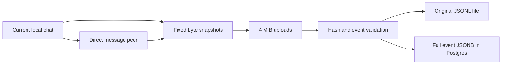

# Codex team history pilot

This pilot builds on PR #78 at `704d8b42eeeed8e59d2da8e7f2d11006e196a8d6`, including its earlier history stack. It adds a private Codex archive to that backend. Codex desktop and CLI local sessions are supported. Codex Cloud and personal review-triage skills are outside this pilot.

The team must approve the destination before users send real history. No deployment or publication is part of this change.

## What agents do

The `codex-history` plugin gives agents a local skill and reminders. After a commit, the agent runs:

```sh
toolreader pilot sync --sha HEAD
```

When preparing or updating a PR, or when asked to sync, the agent runs:

```sh
toolreader pilot sync
```

The agent links its own relevant commits with `--sha COMMIT`. `--role implemented|tested|reviewed|deployed` records the agent's claim. Related chats supply context; they do not inherit its commit claim. PR work triggers sync. No PR relation or PR comment is stored. Existing commit links remain after later uploads and across versions.

The helper uses `CODEX_THREAD_ID`, or an explicit `--session UUID`. It finds that UUID's rollout in `$CODEX_HOME/sessions` or `archived_sessions`. It lists directory names, but never reads unselected files. It validates and snapshots all selected files before uploading. It does not load T3, Claude transcripts, every session in a repo, or parent/child families.

Direct message peers are detected from structured `function_call` records for `send_message_to_thread`, `send_message`, `send_input`, and `followup_task`, and from `inter_agent_message` sender fields. Use `--related UUID` for direct peers identified in actual sent or received messages when the recorded tool uses code mode, an alias, or another envelope. The agent must take these UUIDs from its own message context or tool results. It must not search unrelated sessions. Peer discovery stops at the selected root. A peer's other contacts are not selected.



## Deploy the private backend

1. Review the code and make a team-approved tarball from this checkout. Use Node 24.13.1 or newer in the Node 24 line and pnpm 11.10.0:

   ```sh
   pnpm install --frozen-lockfile
   pnpm exec vp check
   pnpm exec vp run typecheck
   npm pack --pack-destination /absolute/private/release-directory
   ```

2. Install that tarball into a private directory on the deployment host. Set `TOOLREADER_PACKAGE_DIR` to the installed `node_modules/toolreader` directory. Keep it unchanged while the backend runs. The package contains the CLI and `plugins/codex-history`.
3. Set `POSTGRES_PASSWORD` and `TOOLREADER_PACKAGE_DIR` in a private environment file. Use a password safe in a URL, or percent-encode it in a custom database URL. Do not commit the file. Choose `TOOLREADER_PORT` if 4780 is occupied.
4. After deployment authorization, start:

   ```sh
   docker compose --env-file /private/pilot.env -f deploy/codex-pilot.compose.yml up -d
   docker compose --env-file /private/pilot.env -f deploy/codex-pilot.compose.yml ps
   ```

   The API binds `127.0.0.1` inside its container. The forwarding service publishes only host `127.0.0.1:4780`. Postgres has no published port. Put the API behind the team's private HTTPS reverse proxy or approved tunnel for other machines. Do not change the application bind address. The proxy must permit 6 MiB request bodies and a 30-minute finalization response. Apply team authentication/network restrictions there as needed; API writes also require workspace bearer tokens.

5. The backend applies migration 13 at startup. `TOOLREADER_CODEX_ARCHIVE_DIR` must be an absolute path on persistent private storage. Without it, archive requests fail with 422. The supplied Compose file mounts named Postgres and artifact volumes. Back up both together. Existing installations can add the environment setting and volume to their backend service, then run the new CLI build against their existing schema.
6. Create one workspace token per machine, through the container:

   ```sh
   docker compose --env-file /private/pilot.env -f deploy/codex-pilot.compose.yml exec backend \
     node /opt/toolreader/dist/bin.mjs backend token create --workspace TEAM --name MACHINE
   ```

   This prints a credential. Transfer it privately. Do not put it in a plugin, repository, command history or deployment log. Existing `backend token revoke` revokes a machine's token.

7. Check `/v1/health` over the private route. Run one approved synthetic session upload and verify its file hash and SQL rows before onboarding the team.

Logs and shutdown:

```sh
docker compose --env-file /private/pilot.env -f deploy/codex-pilot.compose.yml logs backend
docker compose --env-file /private/pilot.env -f deploy/codex-pilot.compose.yml stop
```

Keep the named volumes. This pilot has no automatic cleanup or retry queue. Failed uploads can leave staging rows, and a transaction failure after a file rename can leave an unreferenced file. Operators must account for these in disk capacity. The existing redacted thread retention/deletion commands do not delete this separate archive. For the pilot, retention is indefinite; an operator must delete a session's `codex_artifacts` rows, `codex_commit_links` rows, pending `codex_uploads` rows and session artifact directory when removal is required. Foreign keys remove its events and selections. Do not enable the pilot where that manual policy is unacceptable.

## Install for each teammate

Install the reviewed tarball with `npm install -g /private/path/toolreader-0.1.0.tgz`. Ensure Node and `toolreader` are on PATH for both Codex desktop and CLI. A desktop app launched outside a terminal can have a different PATH. Confirm the helper from a desktop chat as part of setup.

For a local checkout of the reviewed release:

```sh
codex plugin marketplace add /absolute/path/to/toolreader
codex plugin add codex-history@toolreader-team
codex plugin list --marketplace toolreader-team --json
```

The installed npm package also contains `.agents/plugins/marketplace.json`, so its installed package directory can be used as the marketplace root. For desktop, add that local marketplace in plugin settings and install `codex-history`. Keep the reviewed release directory available until installation completes. Each client uses its installed cached copy. After an upgrade, reinstall or refresh the plugin and review changed hook definitions again.

Run the plugin's setup skill. Merge the backend URL, workspace and per-machine token into `~/.toolreader/config.json`, keeping other settings:

```json
{
  "backend": {
    "url": "https://private-history.example.invalid",
    "workspace": "team",
    "token": "REPLACE_PRIVATELY"
  }
}
```

Restrict the file to the user, for example `chmod 600 ~/.toolreader/config.json`. `TOOLREADER_CONFIG` selects another file. `TOOLREADER_BACKEND_URL`, `TOOLREADER_BACKEND_WORKSPACE`, and `TOOLREADER_BACKEND_TOKEN` override it. Hooks often lack shell environment settings, so prefer the private file.

Review and trust the current `SessionStart`, `PostToolUse`, and `PermissionRequest` hooks in Codex's hook controls. Use `/hooks` in the CLI. Installing or enabling the plugin does not trust it. Do not edit the trust store. Resume or start a chat after installation. The hooks record their input locally. Session and tool hooks also add developer context. They do not upload history or prove that the agent followed the instruction. No model run is part of automated tests. Users can explicitly invoke the history skill if a client does not deliver a reminder.

Do not install the legacy repo-wide git push or Stop capture hooks for this pilot. If a repo already has them, review and disable their toolreader capture configuration before the pilot, preserving other hooks. They can select more history than this pilot permits.

## Read the complete available context

The existing authenticated `toolreader history sql` command and MCP SQL tool can read the workspace-scoped archive views. They have the same read-only login isolation as the existing views. Direct SQL connections can use that workspace's agent login if an operator provides its credentials privately. No new public SQL port is required.

| View                       | Main fields                                                                                                                           |
| -------------------------- | ------------------------------------------------------------------------------------------------------------------------------------- |
| `agent_history_events`     | `session_id`, `version`, `source`, `seq`, `timestamp`, `event_type`, `data`                                                           |
| `agent_codex_artifacts`    | `session_id`, `version`, `bytes`, `event_count`, `file_path`, `uploaded_at`, `root_id`, `source`                                      |
| `agent_codex_events`       | `session_id`, `version`, `seq`, `type`, `at`, `raw`, `payload`, `call_id`, `tool_name`, `tool_arguments`, `tool_input`, `tool_output` |
| `agent_codex_commit_links` | `repo`, `sha`, `session_id`, `role`, `linked_at`                                                                                      |

Each event has a normalized sequence, event type and timestamp. `raw` keeps the whole event object, including unknown fields and event types. `payload` keeps context, messages, reasoning and tool records. `tool_arguments` keeps the full recorded argument value, `tool_input` keeps custom-tool text, and `tool_output` keeps the full recorded result. Match call/result records by `call_id`. Commands nested in code-mode scripts remain in their original script and event payload; no script is executed to interpret them.

Each version is immutable and has a SHA-256. Choose a version explicitly. `agent_codex_artifacts` has one row per root selection and artifact version, so one artifact can appear under multiple roots. File paths are backend-local paths, not public download URLs. An operator with file access can check `sha256sum FILE` against `version`.

```sql
SELECT a.session_id, a.version, a.event_count, a.bytes, a.file_path
FROM agent_codex_commit_links c
JOIN agent_codex_artifacts a ON a.root_id = c.session_id
WHERE c.repo = 'owner/repo' AND c.sha = 'FULL_COMMIT_SHA'
ORDER BY a.uploaded_at DESC;

SELECT seq, type, payload
FROM agent_codex_events
WHERE session_id = 'SESSION_UUID' AND version = 'SHA256'
ORDER BY seq;
```

The existing SQL API limits responses to 1 MB and 1000 rows. Storage does not use these limits. Page rows, and read a large string in pieces. Check `truncated` on every response. For example:

```sql
SELECT seq, substring(tool_output #>> '{}' FROM 1 FOR 100000) AS output_part
FROM agent_codex_events
WHERE session_id = 'SESSION_UUID' AND version = 'SHA256' AND seq = 42;
```

Use subsequent character offsets until the complete string is read. The standard `agent_entries` view still has clipped publication history. The pilot views contain the complete private import and are not included in the standard coverage counts. No coverage audit is part of this pilot.

## Limits and failure behavior

- A session snapshot is the exact byte prefix available when its file opens. Later messages need another explicit sync. A concurrent write can leave partial JSON; that fails validation rather than discarding bytes.
- Artifacts can be up to 1 GiB. Each JSONL record can be up to 32 MiB. Uploads use 4 MiB chunks. The reader keeps one record and chunk in memory, not the whole session. Limit violations fail with an error. There is no truncation fallback. The 1 GiB ceiling is a checked boundary, not a tested throughput claim.
- The backend verifies the byte count, parts, SHA-256 and metadata session id before publishing events. Each artifact's database write is transactional. The full selection is not a distributed transaction: a later session or commit-link failure can leave earlier successful uploads. The CLI exits with failure and does not print its final success message.
- Available data means what Codex actually recorded. Upstream clipping, omitted tool results, encrypted reasoning, external media referenced only by path, and unavailable peer rollouts cannot be recovered here. Transcript formats are not a stable hook API. Unrecognized events remain intact, while malformed envelopes fail. Postgres JSONB rejects unsupported values such as NUL characters in strings; that upload fails rather than replacing them.
- The private archive performs no publication redaction. Treat context, original files, temporary upload rows, backups and SQL credentials as team-private data. All holders of a workspace credential can read that workspace's archive through its SQL route. Use separate workspaces for separate access groups.
- There are no automatic retries, recovery jobs, PR links, Cloud imports, or repo-wide scans. A failed command reports failure. Hooks capture input locally and add reminders; deliberate agent selection remains required for uploads.

## Verification

Run pure tests on the host and database tests in the dedicated Compose project:

```sh
pnpm exec vp test run src/core/codexArchive.test.ts src/server/pilot/Pilot.test.ts
docker compose -f .docker/compose.codex-pilot-test.yml run --rm test
```

The test project uses a private, unpublished Postgres port and tmpfs database storage. Its `pilot-test-modules` volume caches container dependencies. It mounts this checkout at `/work`; it mounts no real session directory or credential file. Stop and recreate only this test project's Postgres container before repeat runs of the existing backend tests, which use fixed workspace names. Do not remove unrelated containers or volumes.

Meaningful checks include multi-chunk original-byte round trips, full SQL output and context, workspace isolation, immutable versions, retained commit links, bad hashes, missing parts, malformed JSON, wrong session identity, direct-peer-only selection and CLI exit status on upload failure. Plugin install/list is checked with an isolated `CODEX_HOME`. The automated tests do not run a model, change a user's trust settings, or upload real sessions. Live desktop hook trust and agent compliance require the onboarding check on each team's supported client version.

Official support references, checked for this implementation:

- [Plugin packaging and private marketplaces](https://developers.openai.com/plugins/build/plugins)
- [Plugin-bundled hooks and trust](https://learn.chatgpt.com/docs/hooks#plugin-bundled-hooks)
- [PostToolUse, including nested code-mode calls](https://learn.chatgpt.com/docs/hooks#posttooluse)
- [Hook input and transcript stability](https://learn.chatgpt.com/docs/hooks#common-input-fields)
- [CLI plugin installation and hook controls](https://learn.chatgpt.com/docs/developer-commands)

Initial pilot validation, before the recorder extension: Codex CLI `0.164.0` installed and enabled both the source plugin and the plugin from the installed npm tarball, each under a temporary `CODEX_HOME`. The installed hook shim emitted the expected `PostToolUse.additionalContext` on Node `24.19.0`. Five pure/file tests and 25 real HTTP/Postgres tests passed. The latter ran on Node `24.19.0` with Postgres `17.5` in Compose, including the bundled CLI subprocess. Format/lint, all three TypeScript projects, viewer/site/CLI builds, `npm pack`, and a tarball install passed. Desktop support is based on the official plugin and hook contracts; live desktop trust UI and a model following the skill were not exercised. No real history was sent.

## Complete event recording, plugin 0.2.0

Migration 14 adds `agent_history_events`, one workspace-scoped read-only view over the private events already stored by the archive. Its columns are `session_id`, `version`, `source`, `seq`, `timestamp`, `event_type`, and `data`. `data` is the complete recorded event JSON. New imports use sources `rollout` and `hook`. Historical eval records with source `app-server` can remain queryable. Existing `agent_entries` and `agent_codex_events` remain compatible. The event view includes metadata, instructions, turn settings, tool definitions, usage, lifecycle records, and unknown event types without requiring a new decoder for each kind. Readable provider reasoning summaries need no new decoder; encrypted reasoning remains opaque.

```sql
SELECT source, version, seq, timestamp, event_type, data
FROM agent_history_events
WHERE session_id = 'SESSION_UUID'
ORDER BY timestamp, source, version, seq
LIMIT 100;
```

Sequence numbers are local to each artifact, not a global causal order. Choose the rollout version you need; each hook invocation is its own immutable artifact. Captured artifacts have an explicit `session_meta` header identifying the session and recorder source. They are generated recorder files, not native Codex rollout files. They retain the complete hook inputs. Every artifact remains linked to its original file and SHA-256. The existing SQL response size and row limits still apply; page or select string slices rather than treating `truncated` responses as complete.

The normalizer now accepts standard MCP image blocks from Codex results and labels snake-case web `open_page`/`find_in_page` actions as fetches. Image storage still requires the existing workspace/bucket opt-in. Fixing image discovery does not silently enable that storage or change its policy.

### Plugin hook capture

After reviewing and trusting the new hook definitions, `SessionStart`, `PostToolUse`, and `PermissionRequest` record their input locally under `$CODEX_HOME/toolreader-events/SESSION/hook/`. Each invocation writes its own file, so concurrent hooks do not share an append cursor. The hooks perform no uploads. `pilot sync` discovers capture files only under selected session IDs, validates them and uploads them with their source. Hook input is bounded at 8 MiB; an exceeded bound fails explicitly. The capture helper writes no permission decision and does not grant or deny a request.

`PermissionRequest` runs before the normal approval flow. It records the question and any supplied turn/tool information. It does **not** receive the user's later answer, and its payload may not include a tool-call ID. Do not infer an exact command/decision link from that hook alone. Hook capture requires a valid `session_id`; missing or invalid input fails visibly.

### Approval capture limit

The pilot does not proxy or record the live app-server connection. The former `pilot app-server` command and its stream recorder have been removed. New syncs read native rollout files and supported hook captures only; old local app-server capture files are ignored. `PermissionRequest` provides the question, not the later answer. Exact approval decisions and other stream-only events are unavailable through this collection path.

The prior synthetic eval retained 70 native rollout events and 289 proxy-captured events. Its stored rows and original files remain historical evidence; the proxy events do not represent current collection support. The 20 compatibility entries, MCP image metadata, readable provider reasoning summaries, and web-action labels came from the rollout reader and remain supported. No new model run is required for the removal.

Proxy removal validation: 31 focused parsing, hook, and normalization tests plus 27 real HTTP/Postgres tests passed. Checks cover rejecting stream-source uploads and ignoring old local stream files. Format/lint, all TypeScript projects, viewer/site/CLI builds, packaging, and a temporary install passed. Both built and installed CLIs reject the removed command. The existing DataGrip eval database remains available with its historical records.
