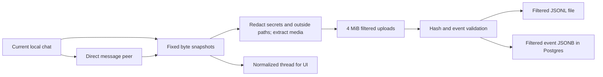

# Codex team history pilot

This pilot builds on PR #78 at `704d8b42eeeed8e59d2da8e7f2d11006e196a8d6`, including its earlier history stack. It stores a normalized thread for the UI and a filtered copy of each selected local Codex rollout for agent SQL. Codex desktop and CLI local sessions are supported. Codex Cloud and personal review-triage skills are outside this pilot.

A three-session size sample is in [filtered-history-size-sample.md](filtered-history-size-sample.md).

The team must approve the destination before users send real history. This checkout has a local isolated deployment path; it does not publish history.

## Choose a sync strategy

Set `TOOLREADER_SYNC_STRATEGY` in the environment of Codex desktop or CLI before starting a chat. The default is `on-demand`. The reviewed plugin hooks use the same `toolreader history sync` uploader in every mode:

| Value       | Automatic trigger                            | Commit link                                                |
| ----------- | -------------------------------------------- | ---------------------------------------------------------- |
| `on-demand` | None; run `toolreader history sync` yourself | Add `--sha COMMIT` when relevant                           |
| `on-commit` | Successful `git commit` PostToolUse result   | Links the current session to `HEAD` after both copies sync |
| `on-push`   | Successful `git push` PostToolUse result     | No inferred commit link; use `--sha` for a claim           |
| `full`      | `SessionEnd` starts a detached upload        | No inferred commit link; use `--sha` for a claim           |

The hook must report a successful exit status for commit and push. A tool result without one does not trigger an automatic upload. The selected session and its direct message peers are included; `--related` is available for peers that need explicit selection. Hook uploads use the repository directory from the Codex event and the default path filter. Use a manual sync to include extra directories. The plugin records every hook event locally, regardless of strategy.

The [Codex hook guide](https://learn.chatgpt.com/docs/hooks) gives `SessionEnd` at most three seconds and always runs it synchronously. It does not run merely because the user leaves a chat; Codex can wait for the chat to end or become idle. Full mode records that event, starts a detached `toolreader history hook-sync` process, and returns. The worker uses the same selected-session uploader and writes `scheduled`, `running`, `succeeded`, or `failed` to `$CODEX_HOME/toolreader-events/SESSION/sync-status.json` with user-only file permissions. Only `succeeded` confirms that the uploader finished. A machine shutdown or hard worker crash can leave an earlier state; there is no automatic retry. Run the history skill explicitly if a sync fails or stays incomplete.

## What agents do

The `codex-history` plugin gives agents a local skill and reminders. After a commit, the agent runs:

```sh
toolreader history sync --sha HEAD
```

When preparing or updating a PR, or when asked to sync, the agent runs:

```sh
toolreader history sync
```

The agent links its own relevant commits with `--sha COMMIT`. `--role implemented|tested|reviewed|deployed` records the agent's claim. Related chats supply context; they do not inherit its commit claim. PR work triggers sync. No PR relation or PR comment is stored. Existing commit links remain after later uploads and across versions.

Local paths inside the repository are kept. Other local machine paths are redacted unless the agent explicitly includes their directories when linking or syncing:

```sh
toolreader history sync --sha HEAD --include-dir ../shared-fixtures
```

`--include-dir` is repeatable and resolves relative to the repository root. Symlinks are resolved before a directory is allowed. The selected canonical directories are stored with each filtered artifact. The option changes path filtering, not session selection. Filtered history keeps ordinary prompt text even when its origin is unclear; it does not try to decide whether pasted text came from an outside file. Secret patterns are redacted. Filtering path strings does **not** remove file contents already pasted into a prompt or command output, and it does not inspect images for personal data.

The helper uses `CODEX_THREAD_ID`, or an explicit `--session UUID`. It finds that UUID's rollout in `$CODEX_HOME/sessions` or `archived_sessions`. It lists directory names, but never reads unselected files. It validates and snapshots all selected files before uploading. It does not load T3, Claude transcripts, every session in a repo, or parent/child families.

Direct message peers are detected from structured `function_call` records for `send_message_to_thread`, `send_message`, `send_input`, and `followup_task`, and from `inter_agent_message` sender fields. Use `--related UUID` for direct peers identified in actual sent or received messages when the recorded tool uses code mode, an alias, or another envelope. The agent must take these UUIDs from its own message context or tool results. It must not search unrelated sessions. Peer discovery stops at the selected root. A peer's other contacts are not selected.



## Deploy the private backend

1. Review the code and make a team-approved tarball from this checkout. Use Node 24.13.1 or newer in the Node 24 line and pnpm 11.10.0:

   ```sh
   pnpm install --frozen-lockfile
   pnpm exec vp check
   pnpm exec vp run typecheck
   npm pack --pack-destination /absolute/private/release-directory
   ```

2. Install that tarball into a private directory on the deployment host. Set `TOOLREADER_PACKAGE_DIR` to the installed `node_modules/toolreader` directory. Keep it unchanged while the backend runs. The package contains the CLI and `plugins/codex-history`.
3. Set `POSTGRES_PASSWORD`, `TOOLREADER_PACKAGE_DIR`, `TOOLREADER_MEDIA_BUCKET`, `TOOLREADER_MEDIA_ACCESS_KEY_ID`, and `TOOLREADER_MEDIA_SECRET_ACCESS_KEY` in a private environment file. Use a password safe in a URL, or percent-encode it in a custom database URL. Do not commit the file. Choose `TOOLREADER_PORT` if 4780 is occupied.
4. After deployment authorization, start:

   ```sh
   docker compose --env-file /private/pilot.env -f deploy/codex-pilot.compose.yml up -d
   docker compose --env-file /private/pilot.env -f deploy/codex-pilot.compose.yml ps
   ```

   The API binds `127.0.0.1` inside its container. The forwarding service publishes only host `127.0.0.1:4780`. Postgres has no published port. Put the API behind the team's private HTTPS reverse proxy or approved tunnel for other machines. Do not change the application bind address. The proxy must permit 6 MiB request bodies and a 30-minute finalization response. Apply team authentication/network restrictions there as needed; API writes also require workspace bearer tokens.

5. The backend applies migrations through 15 at startup. `TOOLREADER_CODEX_ARCHIVE_DIR` must be an absolute path on persistent private storage. Without it, archive requests fail with 422. The supplied Compose file mounts named Postgres and artifact volumes. Back up both together. Existing installations can add the environment setting and volume to their backend service, then run the new CLI build against their existing schema. Exact unfiltered file retention is off by default. To retain an exact copy for a selected upload, set `TOOLREADER_CODEX_RETAIN_EXACT=true` on the backend and use `toolreader history sync --retain-exact` on the client; either setting alone is insufficient.
6. Create one workspace token per machine, through the container:

   ```sh
   docker compose --env-file /private/pilot.env -f deploy/codex-pilot.compose.yml exec backend \
     node /opt/toolreader/dist/bin.mjs backend token create --workspace TEAM --name MACHINE
   ```

   This prints a credential. Transfer it privately. Do not put it in a plugin, repository, command history or deployment log. Existing `backend token revoke` revokes a machine's token.

7. Check `/v1/health` over the private route. Run one approved synthetic session upload and verify its file hash and SQL rows before onboarding the team.

The isolated Compose stack runs RustFS on host loopback port 9009. Create the named private bucket through its S3 API, then enable media for the workspace with `toolreader backend media enable --workspace WORKSPACE`. Filtered imports replace supported embedded images and readable path-only images with `toolreader-media:<sha256>` references. If a selected image cannot be read, the event gets a missing-media marker. A referenced image must upload before the filtered event copy; sync fails if the workspace has no configured media bucket. The backend proxies media retrieval, and `toolreader history media SHA256 -o FILE` writes a cited image locally after hash verification. The MCP `media` tool returns the same cited image to an agent.

Logs and shutdown:

```sh
docker compose --env-file /private/pilot.env -f deploy/codex-pilot.compose.yml logs backend
docker compose --env-file /private/pilot.env -f deploy/codex-pilot.compose.yml stop
```

Keep the named volumes. This task does not change the general retention or deletion policy. Failed uploads can leave staging rows, and a transaction failure after a file rename can leave an unreferenced file. Operators must account for these in disk capacity. Existing exact artifacts are hidden from agent SQL after migration 15. A successful filtered backfill of the same source version removes the matching legacy exact file when exact retention is off. Unmatched legacy files remain private and are reported by `history backfill`; they must not be mistaken for filtered copies. The existing redacted thread removal commands do not cover this archive.

## Install for each teammate

Install the reviewed tarball with `npm install -g /private/path/toolreader-0.1.0.tgz`. Ensure Node and `toolreader` are on PATH for both Codex desktop and CLI. A desktop app launched outside a terminal can have a different PATH. Confirm the helper from a desktop chat as part of setup.

For a local checkout of the reviewed release:

```sh
codex plugin marketplace add /absolute/path/to/toolreader
codex plugin add codex-history@toolreader-team
codex plugin list --marketplace toolreader-team --json
```

The installed npm package also contains `.agents/plugins/marketplace.json`, so its installed package directory can be used as the marketplace root. For desktop, add that local marketplace in plugin settings and install `codex-history`. Keep the reviewed release directory available until installation completes. Each client uses its installed cached copy. After an upgrade, reinstall or refresh the plugin and review changed hook definitions again.

Run the plugin's setup skill. Merge the backend URL, workspace and per-machine token into `~/.toolreader/config.json`, keeping other settings:

```json
{
  "backend": {
    "url": "https://private-history.example.invalid",
    "workspace": "team",
    "token": "REPLACE_PRIVATELY"
  }
}
```

Restrict the file to the user, for example `chmod 600 ~/.toolreader/config.json`. `TOOLREADER_CONFIG` selects another file. `TOOLREADER_BACKEND_URL`, `TOOLREADER_BACKEND_WORKSPACE`, and `TOOLREADER_BACKEND_TOKEN` override it. Hooks often lack shell environment settings, so prefer the private file.

Review and trust the current `SessionStart`, `PostToolUse`, `PermissionRequest`, and `SessionEnd` hooks in Codex's hook controls. Use `/hooks` in the CLI. Installing or enabling the plugin does not trust it. Do not edit the trust store. Resume or start a chat after installation. The hooks record their input locally. The selected strategy can upload on a matching event. A hook invocation alone does not prove delivery; inspect its result and backend receipt. No model run is part of automated tests. Users can explicitly invoke the history skill if a client does not deliver a reminder.

Do not install the legacy repo-wide git push or Stop capture hooks for this pilot. If a repo already has them, review and disable their toolreader capture configuration before the pilot, preserving other hooks. They can select more history than this pilot permits.

## Query normalized and filtered history

The existing authenticated `toolreader history sql` command and MCP SQL tool can read both representations through workspace-scoped, read-only views. Direct SQL connections can use that workspace's agent login if an operator provides its credentials privately. No new public SQL port is required. Writer tokens are trusted to run the local filter before upload; the backend validates artifact identity, hashes, shape and workspace access, but cannot independently reconstruct local symlink/path scope.

| View                              | Main fields                                                                                                                               |
| --------------------------------- | ----------------------------------------------------------------------------------------------------------------------------------------- |
| `agent_threads` / `agent_entries` | Normalized thread and clipped entries for the UI and convenient SQL queries                                                               |
| `agent_filtered_rollouts`         | `session_id`, `version`, `source_sha256`, `source`, `bytes`, `event_count`, `included_directories`, `uploaded_at`                         |
| `agent_history_events`            | `session_id`, `version`, `source`, `seq`, `timestamp`, `event_type`, `data` (filtered recorded object)                                    |
| `agent_codex_artifacts`           | `session_id`, `version`, `bytes`, `event_count`, `file_path`, `uploaded_at`, `root_id`, `source`, `source_sha256`, `included_directories` |
| `agent_codex_events`              | `session_id`, `version`, `seq`, `type`, `at`, `raw`, `payload`, `call_id`, `tool_name`, `tool_arguments`, `tool_input`, `tool_output`     |
| `agent_codex_commit_links`        | `repo`, `sha`, `session_id`, `role`, `linked_at`                                                                                          |

Each filtered event has its original sequence, event type and timestamp. `raw`/`data` keep the recorded event object after filtering, including unknown event types, readable and encrypted reasoning, token counts, lifecycle records, plans, per-turn settings, and full recorded tool inputs and outputs. There is no new length clipping. Match call/result records by `call_id`. Commands nested in code-mode scripts remain in their script and event payload; no script is executed to interpret them. The normalized `agent_entries` view is still clipped and may merge or skip native records.

Each filtered version is immutable and has a SHA-256 of the **filtered** JSONL bytes. `source_sha256` identifies the selected original source snapshot. Choose a version explicitly for consistent queries; `seq` is ordered within one source/version. The original and filtered hashes can differ because secrets, paths, and media change. `agent_codex_artifacts` has one row per root selection and artifact version, so one artifact can appear under multiple roots. Its `file_path` field is null in agent SQL; the private backend path is not exposed.

```sql
SELECT a.session_id, a.version, a.event_count, a.bytes,
       a.source_sha256, a.included_directories
FROM agent_codex_commit_links c
JOIN agent_codex_artifacts a ON a.root_id = c.session_id
WHERE c.repo = 'owner/repo' AND c.sha = 'FULL_COMMIT_SHA'
ORDER BY a.uploaded_at DESC;

SELECT seq, event_type, data
FROM agent_history_events
WHERE session_id = 'SESSION_UUID' AND version = 'FILTERED_SHA256'
ORDER BY seq;
```

The existing SQL API limits responses to 1 MB and 1000 rows. Storage does not use these limits. Page rows, and read a large string in pieces. Check `truncated` on every response. For example:

```sql
SELECT seq, substring(tool_output #>> '{}' FROM 1 FOR 100000) AS output_part
FROM agent_codex_events
WHERE session_id = 'SESSION_UUID' AND version = 'FILTERED_SHA256' AND seq = 42;
```

Use subsequent character offsets until the complete recorded string is read. To retrieve a `toolreader-media:<sha256>` reference, run `toolreader history media SHA256 -o FILE` or call the MCP `media` tool with the hash. A `[missing-media]` or `[media-outside-scope]` marker means the original bytes were not imported. The pilot views are not included in the standard coverage counts.

## Limits and failure behavior

- A local source snapshot is the exact byte prefix available when its file opens. It is filtered before upload and deleted from the temporary directory after sync. Later messages need another explicit sync. A concurrent write can leave partial JSON; that fails validation rather than discarding bytes.
- Artifacts can be up to 1 GiB. Each JSONL record can be up to 32 MiB. Uploads use 4 MiB chunks. The reader keeps one record and chunk in memory, not the whole session. Limit violations fail with an error. There is no truncation fallback. The 1 GiB ceiling is a checked boundary, not a tested throughput claim.
- The backend verifies the filtered byte count, parts, SHA-256 and metadata session id before publishing events. Each artifact's database write is transactional. The full selection is not a distributed transaction: a later session, normalized record or commit-link failure can leave earlier successful uploads. The CLI exits with failure and does not print its final success message.
- Available data means what Codex actually recorded **after filtering**. Upstream clipping and omitted tool results cannot be recovered. Encrypted reasoning remains recorded but unreadable. Missing path-only media is marked; no text is invented. Transcript formats are not a stable hook API. Unrecognized events remain intact, while malformed envelopes fail. Postgres JSONB rejects unsupported values such as NUL characters in strings; that upload fails rather than replacing them.
- Treat filtered context, optional exact files, temporary upload rows, backups and SQL credentials as team-private data. Redaction is a bounded safeguard, not a guarantee that copied text or images contain no private information. All holders of a workspace credential can read its filtered archive through SQL. Use separate workspaces for separate access groups.
- There are no automatic retries, recovery jobs, PR links, Cloud imports, or repo-wide scans. A failed command reports failure. Hooks capture input locally and add reminders; deliberate agent selection remains required for uploads.

## Backfill existing imports

Migration 15 marks existing private Codex artifacts as legacy `exact` copies and immediately removes them from every agent raw-history view. Run the reviewed client on a machine that still has the selected source files:

```sh
toolreader history backfill
toolreader history backfill --include-dir ../shared-fixtures
```

The command lists legacy session/source/version metadata from the workspace and uses each local rollout's recorded working directory to choose its path filter. `--repo DIR` overrides that directory for all selected sessions. It reimports available local selected sessions as filtered copies, then reports each legacy artifact that lacks a matching filtered `source_sha256`. A missing local source, changed source hash, invalid source or upload failure is reported, not counted as success. When a matching filtered copy is accepted and exact retention is off, the backend transfers its selections and removes that matching old exact file. Other legacy exact files stay private but inaccessible through agent SQL until they can be backfilled. Inspect the backfill report and the backend's private archive volume for remaining legacy files; this task does not change the archive's general retention or deletion policy.

## Verification

Run pure tests on the host and database tests in the dedicated Compose project:

```sh
pnpm exec vp test run src/core/codexArchive.test.ts src/server/pilot/Pilot.test.ts
docker compose -f .docker/compose.codex-pilot-test.yml run --rm test
```

The test project uses a private, unpublished Postgres port and tmpfs database storage. Its `pilot-test-modules` volume caches container dependencies. It mounts this checkout at `/work`; it mounts no real session directory or credential file. Stop and recreate only this test project's Postgres container before repeat runs of the existing backend tests, which use fixed workspace names. Do not remove unrelated containers or volumes.

Meaningful checks include multi-chunk original-byte round trips, full SQL output and context, workspace isolation, immutable versions, retained commit links, bad hashes, missing parts, malformed JSON, wrong session identity, direct-peer-only selection and CLI exit status on upload failure. Plugin install/list is checked with an isolated `CODEX_HOME`. The automated tests do not run a model, change a user's trust settings, or upload real sessions. Live desktop hook trust and agent compliance require the onboarding check on each team's supported client version.

Official support references, checked for this implementation:

- [Plugin packaging and private marketplaces](https://developers.openai.com/plugins/build/plugins)
- [Plugin-bundled hooks and trust](https://learn.chatgpt.com/docs/hooks#plugin-bundled-hooks)
- [PostToolUse, including nested code-mode calls](https://learn.chatgpt.com/docs/hooks#posttooluse)
- [Hook input and transcript stability](https://learn.chatgpt.com/docs/hooks#common-input-fields)
- [CLI plugin installation and hook controls](https://learn.chatgpt.com/docs/developer-commands)

Initial pilot validation, before the recorder extension: Codex CLI `0.164.0` installed and enabled both the source plugin and the plugin from the installed npm tarball, each under a temporary `CODEX_HOME`. The installed hook shim emitted the expected `PostToolUse.additionalContext` on Node `24.19.0`. Five pure/file tests and 25 real HTTP/Postgres tests passed. The latter ran on Node `24.19.0` with Postgres `17.5` in Compose, including the bundled CLI subprocess. Format/lint, all three TypeScript projects, viewer/site/CLI builds, `npm pack`, and a tarball install passed. Desktop support is based on the official plugin and hook contracts; live desktop trust UI and a model following the skill were not exercised. No real history was sent.

## Hook capture and approval limit

After reviewing and trusting the plugin hooks, `SessionStart`, `PostToolUse`, `PermissionRequest`, and `SessionEnd` record their input locally under `$CODEX_HOME/toolreader-events/SESSION/hook/`. Each invocation writes its own file. Hook files are filtered with the selected session before upload and retain source `hook` in the agent SQL views. The strategy controls automatic uploads.

`PermissionRequest` runs before the normal approval flow. It records the request, not the user's later decision, and may lack a tool-call ID. Do not infer an exact command/decision link from that hook alone. The pilot does not proxy app-server traffic.

## Local review on 2026-10-30

The filtered rollout now feeds normalization as well as the complete event archive. A manual `--redact-file` JSON list adds exact value replacements to both paths. File URLs outside selected directories and unknown `encrypted_content` are removed; reasoning ciphertext with the expected opaque shape stays. The normalized record reads a subagent parent from its selected rollout. A repeated upload of the same filtered bytes and source can update its recorded directory list. Media cleanup checks embedded references in filtered events.

Ten synthetic tests passed for filtering, normalization, all four sync decisions, and the detached full-mode timeout. Format and lint, server TypeScript, and the viewer/site/CLI build passed. The CLI rejected an old `history sync --range ... --hook` invocation with an explicit reinstall message and uploaded nothing. The new directory re-sync test and existing HTTP/Postgres media, workspace isolation, resumed session, and retrieval tests could not run here because the local Docker socket was unavailable. Live Codex desktop environment propagation and hook trust were not exercised. Real sessions and private media were not uploaded.

The filter cannot find an arbitrary pasted secret without a known pattern or a local redaction list. It cannot inspect text or personal data inside image pixels. When exact retention is disabled, `codexStart` refuses new exact uploads. An older exact upload interrupted after staging can still leave bytes in `codex_upload_parts`; no staging cleanup is implemented. Operators must treat those rows as retained private material until a reviewed cleanup policy is applied.
